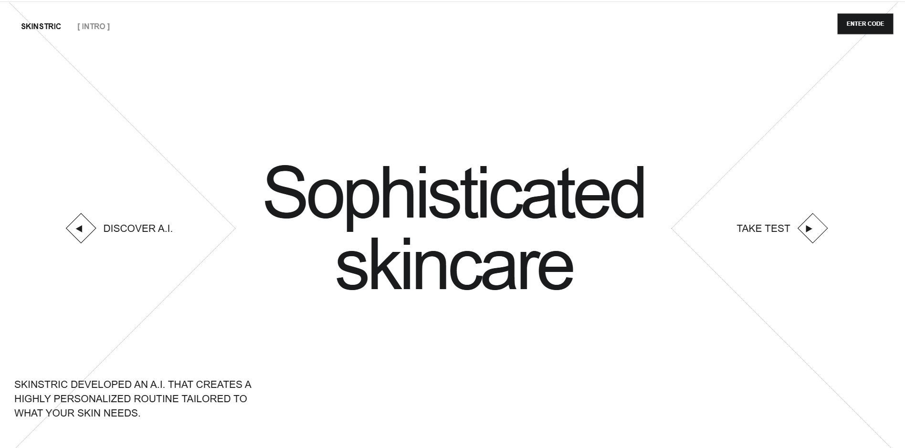

</> Markdown

## Skinstric A.I. App Screenshot



## 🛠️ Tech Stack

* Next.js 16 – React framework with App Router
* React 19 – Builds the user interface
* TypeScript – Type-safe JavaScript
* Tailwind CSS 4 – Utility-first responsive styling
* Lucide React – Lightweight icon library
* REST API – Sends photos for AI analysis
* MediaDevices API – Captures photos with the device camera
* ESLint – Keeps code quality consistent
* GitHub Actions – Runs automated lint checks
* Vercel – Hosting and deployment

### 🚀 Key Features

* 👤 Guided onboarding: Users enter their name and location, and inputs are checked before continuing.
* 📸 Live camera capture: Users take a headshot in the browser, with an option to retake it.
* 🖼️ Image upload: Users can upload a photo from their device instead of using the camera.
* 🤖 AI face analysis: The photo is sent to Skinstric's REST API for analysis.
* 📊 Demographics results: The app shows predicted race, age and sex, each with a confidence percentage.
* 🎯 Interactive results: Users can click a different prediction in any category to see it instead.
* ⚠️ Error handling: Clear messages appear for invalid input, camera problems and failed requests.
* ✨ Animated, responsive UI: Rotating diamond graphics and smooth hover effects work on any screen size.
  
## Skinstric A. I. App

🔗 **Live Demo:** [View Live Website](https://skinstricaiapp-gold.vercel.app/)

A Next.js AI app that analyzes headshots for personalized skincare.

## Skinstric A.I. App Run Instructions

These steps explain how to set up, run, and debug the Skinstric A.I. app locally on Windows with VS Code.

### 1. Prerequisites

Install these tools first:

| Tool | Version | Notes |
| --- | --- | --- |
| Node.js | 20.9.0 or newer (LTS) | Next.js 16 needs at least 20.9.0. npm comes with it. [Download Node.js](https://nodejs.org/) |
| Git | Latest | Used to clone the repository. [Download Git](https://git-scm.com/) |
| Visual Studio Code | Latest | Suggested extensions: ESLint, Tailwind CSS IntelliSense |
| Browser | Chrome or Edge | Needs camera access for the photo step |

Check that they're installed (PowerShell or Command Prompt):

```powershell
node -v    # should print v20.9.0 or higher
npm -v
git --version
```

If `node` or `npm` isn't recognized, reinstall Node.js, then close and reopen your terminal or VS Code.

### 2. Clone the Repository and Install Dependencies

```powershell
git clone https://github.com/jkarnwie2000/SkinstricAIApp.git
cd SkinstricAIApp
npm ci
```

`npm ci` installs the exact dependency versions listed in `package-lock.json`. If it fails because the lockfile doesn't match `package.json`, run `npm install` instead.

Open the project in VS Code:

```powershell
code .
```

### 3. Environment Variables

You don't need any environment variables. The project has no `.env` or `.env.example` file, and the code doesn't read `process.env`.

The app calls two public Skinstric API endpoints, and their URLs are already in the code:

| Endpoint | Used in | Purpose |
| --- | --- | --- |
| `https://us-central1-api-skinstric-ai.cloudfunctions.net/skinstricPhaseOne` | `app/photo/page.tsx` | Sends the user's name and location |
| `https://us-central1-api-skinstric-ai.cloudfunctions.net/skinstricPhaseTwo` | `app/analysis/page.tsx` | Sends the image and returns the demographic predictions |

If you later move these URLs into environment variables, put them in a `.env.local` file in the project root. Browser code can only read variables whose names start with `NEXT_PUBLIC_` (for example, `NEXT_PUBLIC_API_BASE_URL`). Restart the dev server after you change `.env.local`. Don't commit that file.

### 4. Run the Project in Development Mode

```powershell
npm run dev
```

Then open [http://localhost:3000](http://localhost:3000) in your browser. Press `Ctrl + C` in the terminal to stop the server.

The app moves through these routes:

| Route | File | Step |
| --- | --- | --- |
| `/` | `app/page.tsx` | Landing page |
| `/testing` | `app/testing/page.tsx` | Enter your name |
| `/photo` | `app/photo/page.tsx` | Enter your location |
| `/upload` | `app/upload/page.tsx` | Take a photo or upload one |
| `/analysis` | `app/analysis/page.tsx` | Image is sent for AI analysis |
| `/results` | `app/results/page.tsx` | Demographics results |

> **Camera note:** Browsers only allow camera access on `localhost` or over HTTPS. If you open the dev server from another device using your computer's IP address, the camera won't start. Use the upload option there instead.

### 5. Build and Run the Production Version

```powershell
npm run build
npm run start
```

Then open [http://localhost:3000](http://localhost:3000). After any code change, run `npm run build` again before `npm run start`.

### 6. Available npm Commands

| Command | Description |
| --- | --- |
| `npm ci` | Installs the exact versions from `package-lock.json` |
| `npm install` | Installs dependencies and updates the lockfile if needed |
| `npm run dev` | Starts the development server with hot reload |
| `npm run build` | Creates an optimized production build |
| `npm run start` | Serves the production build |
| `npm run lint` | Runs ESLint (the same check GitHub Actions runs) |
| `npx tsc --noEmit` | Checks TypeScript types without writing output files |

### 7. Debug with VS Code

The repository includes `.vscode/launch.json` with three debug configurations:

| Configuration | What it does |
| --- | --- |
| **Next.js: debug server-side** | Runs `npm run dev -- --inspect` and attaches the debugger to the Node.js server |
| **Next.js: debug client-side** | Opens Chrome at `http://localhost:3000` with the debugger attached. Start `npm run dev` first. |
| **Next.js: debug full stack** | Starts the dev server and opens Edge with the debugger attached to both server and browser |

To start debugging:

1. Open the **Run and Debug** panel (`Ctrl + Shift + D`).
2. Choose a configuration from the dropdown.
3. Press `F5`.
4. Set breakpoints by clicking in the gutter beside a line number.

Most of this app's logic runs in the browser: camera capture, `localStorage`, API `fetch` calls, and rendering the results. So **debug full stack** or **debug client-side** is usually the right choice. Good places for breakpoints:

* `app/components/UploadOptions.tsx`: camera capture and image upload
* `app/analysis/page.tsx`: the API request for image analysis
* `app/results/page.tsx`: how the results are processed and displayed

### 8. Troubleshooting

| Problem | Solution |
| --- | --- |
| `node` or `npm` isn't recognized | Reinstall Node.js 20.9+ and reopen the terminal |
| Port 3000 is already in use | Run `npm run dev -- --port 3001` and open `http://localhost:3001` |
| The camera doesn't start | Allow camera access in the browser's site settings, close other apps using the camera, and use `localhost` |
| The analysis or results page shows an error | Check the browser DevTools **Network** and **Console** tabs for the API response and status code |
| "Please go back and enter your name first" | Start again at `/testing`. The name is saved in `localStorage` and the later steps need it. |
| Strange build errors after changing dependencies | Delete the `.next` and `node_modules` folders, then run `npm ci` again |
| VS Code debugger doesn't stop at breakpoints | Make sure you picked the right configuration and the page has finished loading at `http://localhost:3000` |

### 9. Quick Start

```powershell
git clone https://github.com/jkarnwie2000/SkinstricAIApp.git
cd SkinstricAIApp
npm ci
npm run dev
```

Open [http://localhost:3000](http://localhost:3000).

---

This is a [Next.js](https://nextjs.org) project bootstrapped with [`create-next-app`](https://nextjs.org/docs/app/api-reference/cli/create-next-app).

## Getting Started

First, run the development server:

```bash
npm run dev
# or
yarn dev
# or
pnpm dev
# or
bun dev
```

Open [http://localhost:3000](http://localhost:3000) with your browser to see the result.

You can start editing the page by modifying `app/page.tsx`. The page auto-updates as you edit the file.

This project uses [`next/font`](https://nextjs.org/docs/app/building-your-application/optimizing/fonts) to automatically optimize and load [Geist](https://vercel.com/font), a new font family for Vercel.

## Learn More

To learn more about Next.js, take a look at the following resources:

- [Next.js Documentation](https://nextjs.org/docs) - learn about Next.js features and API.
- [Learn Next.js](https://nextjs.org/learn) - an interactive Next.js tutorial.

You can check out [the Next.js GitHub repository](https://github.com/vercel/next.js) - your feedback and contributions are welcome!

## Deploy on Vercel

The easiest way to deploy your Next.js app is to use the [Vercel Platform](https://vercel.com/new?utm_medium=default-template&filter=next.js&utm_source=create-next-app&utm_campaign=create-next-app-readme) from the creators of Next.js.

Check out our [Next.js deployment documentation](https://nextjs.org/docs/app/building-your-application/deploying) for more details.
# julius-skinstric-project

## Successfully Completed Lighthouse Accessibility Audit 
Audited project with Lighthouse and axe DevTools and adjusted contrast, alt text, form labels, and focus states, to bring the accessibility score from the initial 63% to 100%, to ensure a smooth browsing experience for text readers and users.

## Successfully Completed Lighthouse Performance Audit 
I ran performance audit and corrected the LCP element to take website performance from 76% to 95%.

## Successfully run CI awareness (GitHub Actions) using npm run lint


## 🤖Automated Code Linting with GitHub Actions

This project uses **GitHub Actions** to automatically run code linting checks whenever code is pushed to the repository or a pull request is opened or updated.

### How It Works

The CI (Continuous Integration) workflow, named `Skinstric CI`, runs on an Ubuntu Linux environment and performs the following steps:

1. **Check Out the Repository:** Uses `actions/checkout@v4` to retrieve the project's source code.
2. **Set Up Node.js:** Uses `actions/setup-node@v4` to configure Node.js version 20.
3. **Install Dependencies:** Runs `npm install` to install the project's dependencies required for linting.
4. **Run Lint Checks:** Executes `npm run lint` to identify potential code quality issues according to the linting rules configured in the project.

### Workflow Triggers

The workflow runs automatically on:

* **Push events:** When commits are pushed to the repository.
* **Pull request events:** When a pull request is opened or updated.

### Benefits

* **Automated Code Quality Checks:** Helps identify potential code issues early in the development process.
* **Consistent Development Standards:** Applies the project's configured linting rules across code changes.
* **Continuous Integration:** Provides automated feedback on linting results through GitHub Actions.
* **Improved Maintainability:** Helps maintain cleaner, more consistent code throughout the project.

**Note:** This workflow automates linting only. It does not explicitly run unit tests, build the application, or deploy the website. Its success depends on the `npm run lint` script being correctly configured in `package.json` and the code passing the configured linting checks.


