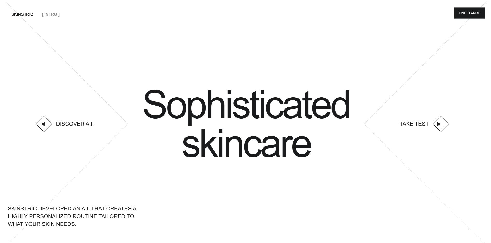

</> Markdown

## Skinstric A.I. App Screenshot



## 🛠️ Tech Stack

* React — User interface development.
* TypeScript — Static type checking to JavaScript.
* Next.js — React framework for building web applications.
* REST API — Communication with web services through REST endpoints.

### 🚀 Key Features

*  📚 AI-Powered Skin Analysis: Captures and uploads customer headshots for personalized skin analysis using generative AI technology.
*  ⚡ Personalized Skincare Recommendations: Analyzes individual skin characteristics to recommend tailored skincare routines based on each customer's unique evaluation.
*  🎯 Interactive User Experience: Delivers a modern, responsive interface that simplifies image uploads, AI-driven analysis, and personalized skincare guidance.

## Skinstric A. I. App

🔗 **Live Demo:** [View Live Website](https://julius-skinstric-projectpearls.vercel.app/)

A Next.js and React application that analyzes the customer's headshot image and determines the best skincare routine for the client using A. I.

## Skinstric A.I. App Run Instructions

Follow these instructions to install, configure, and run the Skinstric A.I. Website locally.

## Prerequisites

Before getting started, make sure you have the following installed:

* **Node.js:** Use a supported LTS version compatible with your installed Next.js version.
* **npm:** The Node.js package manager, included with Node.js.
* **Git:** Required if you plan to clone the repository from GitHub.
* **Visual Studio Code:** Recommended for editing and managing the project.
* **Web browser:** Use a modern browser such as Google Chrome, Microsoft Edge, or Firefox.

Verify that Node.js and npm are installed by running the following commands in your terminal:

```bash
node -v
npm -v
```

If either command fails, install Node.js from the official website:

[Download Node.js](https://nodejs.org/)

To verify that Git is installed, run:

```bash
git --version
```

If necessary, install Git from the official website:

[Download Git](https://git-scm.com/)

### 1. Clone the Repository

Open a terminal and navigate to the directory where you want to store the project.

Clone your GitHub repository using the following command:

```bash
git clone YOUR_REPOSITORY_URL
```

Replace `YOUR_REPOSITORY_URL` with your actual GitHub repository URL.

Navigate into the project directory:

```bash
cd YOUR_PROJECT_DIRECTORY
```

Replace `YOUR_PROJECT_DIRECTORY` with the name of the cloned repository.

Alternatively, if you have already downloaded the project, open its root directory in Visual Studio Code.

### 2. Install Dependencies

Make sure your terminal is open in the project root directory, where `package.json` and `package-lock.json` are located.

Install the project dependencies:

```bash
npm install
```

This command installs the dependencies declared in `package.json` and generates or updates the local `node_modules` directory.

**Recommended:** If you already have a valid `package-lock.json` and want a clean, reproducible installation, use:

```bash
npm ci
```

Use `npm ci` for a fresh installation when the lockfile matches `package.json`. It removes the existing `node_modules` directory before installing the locked dependencies.

You do not need to run both commands. Choose the one appropriate for your situation.

### 3. Configure Environment Variables

If your application connects to an external REST API or requires other environment-specific configuration, create a `.env.local` file in the project root.

Your project structure should look similar to this:

```text
Skinstric-AI-Website/
├── app/
├── public/
├── .env.local
├── package.json
├── package-lock.json
├── next.config.ts
└── tsconfig.json
```

Add the environment variables required by your application to `.env.local`.

For example, if your application uses an external REST API, you might configure:

```dotenv
# Base URL for the external REST API
API_BASE_URL=https://api.example.com

# Public API URL, only if required by browser-side code
NEXT_PUBLIC_API_URL=https://api.example.com
```

**Important:** These are illustrative examples, not verified configuration variables for this project. Replace the example URL with the actual API endpoint and use the variable names expected by your application.

If your application does not require environment variables, you can skip this step.

#### Environment Variable Security

* Keep `.env.local` in the project root.
* Never commit API secrets, private keys, or access tokens to GitHub.
* Do not use the `NEXT_PUBLIC_` prefix for private credentials. Variables with this prefix can be exposed to browser-side code.
* Add `.env.local` to `.gitignore` if it is not already excluded.
* Restart the development server after changing environment variables.

Example `.gitignore` entries:

```gitignore
node_modules/
.next/
.env*
!.env.example
```

If you use this example, commit an `.env.example` file containing only placeholder values and no real secrets.

### 4. Start the Development Server

After installing dependencies and configuring any required environment variables, start the application:

```bash
npm run dev
```

Once the development server starts, open your browser and navigate to:

```text
http://localhost:3000
```

The application should load locally.

Your Next.js application uses the App Router, with the main page defined in `app/page.tsx`.

The project also includes additional routes:

| Route       | File                    |
| ----------- | ----------------------- |
| `/`         | `app/page.tsx`          |
| `/analysis` | `app/analysis/page.tsx` |
| `/photo`    | `app/photo/page.tsx`    |
| `/results`  | `app/results/page.tsx`  |
| `/testing`  | `app/testing/page.tsx`  |
| `/upload`   | `app/upload/page.tsx`   |

You can access these routes directly in your browser while the development server is running.

**Note:** The routes above are inferred from the supplied directory structure. Their availability and behavior depend on the implementation of each page.

To stop the development server, press:

```text
Ctrl + C
```

### 5. Build and Run the Production Version

To prepare the application for production, first create an optimized build:

```bash
npm run build
```

If the build completes successfully, start the production server:

```bash
npm run start
```

Open your browser and navigate to:

```text
http://localhost:3000
```

The production server serves the previously generated build.

**Important:** The production server requires a successful build first. If you change the application code, rebuild it before starting the updated production version.

### 6. Available npm Commands

The following commands are commonly used in Next.js projects.

| Command            | Description                                              |
| ------------------ | -------------------------------------------------------- |
| `npm install`      | Installs project dependencies.                           |
| `npm ci`           | Installs dependencies from the existing lockfile.        |
| `npm run dev`      | Starts the development server.                           |
| `npm run build`    | Creates an optimized production build.                   |
| `npm run start`    | Starts the production server.                            |
| `npm run lint`     | Runs the lint script, if configured.                     |
| `npx tsc --noEmit` | Checks TypeScript types without generating output files. |

**Note:** The availability of npm scripts depends on the contents of `package.json`. The development, build, and start scripts are standard for Next.js projects, but confirm that they are defined in your project before using them.

If `npm run lint` fails because the script is missing, inspect `package.json` and the installed ESLint configuration. Recent Next.js versions no longer provide the `next lint` command, so use the linting approach supported by your installed version.

### 7. Troubleshooting

#### Problem: `npm` or `node` Is Not Recognized

**Possible cause:** Node.js is not installed correctly, or its installation directory is missing from your system's PATH.

**Solution:**

1. Install a supported Node.js LTS release.
2. Close and reopen your terminal or Visual Studio Code.
3. Run the following commands again:

   ```bash
   node -v
   npm -v
   ```

#### Problem: Dependencies Fail to Install

**Possible causes:** An outdated npm version, network issues, or a mismatch between `package.json` and `package-lock.json`.

**Solution:**

1. Confirm that you are in the project root directory.
2. Check that both package files exist.
3. Review the error message for dependency conflicts.
4. If the lockfile is valid and synchronized with `package.json`, run:

   ```bash
   npm ci
   ```

If the error persists, inspect the specific dependency reported in the terminal rather than immediately deleting the lockfile.

#### Problem: Port 3000 Is Already in Use

**Possible cause:** Another application is using port 3000.

**Solution:** Start the development server on another port:

```bash
npm run dev -- --port 3001
```

Then open:

```text
http://localhost:3001
```

The same port option can be used with the production start script:

```bash
npm run start -- --port 3001
```

#### Problem: Environment Variables Are Undefined

**Possible cause:** The variable is missing, incorrectly named, or was added after the server started.

**Solution:**

1. Verify that `.env.local` is in the project root.
2. Confirm that the variable name matches the name referenced in your code.
3. Restart the development server.
4. Check that private environment variables are accessed only in server-side code.

Remember that browser-side code can access only appropriately exposed public variables, such as those prefixed with `NEXT_PUBLIC_`.

#### Problem: REST API Requests Fail

**Possible causes:** An incorrect API URL, invalid credentials, server errors, or browser CORS restrictions.

**Solution:**

1. Verify the API endpoint and required credentials.
2. Check the browser's Developer Tools under **Network** and **Console**.
3. Inspect the HTTP status code returned by the API.
4. Confirm that the API server allows requests from your application's origin.
5. If the API requires private credentials, consider making the request through a Next.js server-side route instead of exposing the credentials in browser code.

#### Problem: Images or Static Assets Do Not Display

**Possible cause:** An incorrect asset path.

**Solution:**

For files stored in the `public` directory, reference the path relative to `public`.

For example, the supplied project structure includes:

```text
public/assets/camera.svg
public/assets/gallery.svg
public/assets/Best Image.png
```

These assets can be referenced in the browser using paths such as:

```text
/assets/camera.svg
/assets/gallery.svg
/assets/Best%20Image.png
```

When using Next.js components, ensure that image paths and filenames match the actual files, including capitalization and spaces.

#### Problem: The Production Build Fails

**Possible causes:** TypeScript errors, ESLint errors, missing environment variables, or invalid application code.

**Solution:**

1. Read the full error message in the terminal.
2. Correct any reported TypeScript or application errors.
3. Confirm that required environment variables are available during the build when needed.
4. Run the build again:

   ```bash
   npm run build
   ```

Do not attempt to start the production server until the build succeeds.

### 8. Project Structure

The application uses the Next.js App Router and organizes its pages, components, and static assets into separate directories.

```text
app/
├── analysis/
│   └── page.tsx
├── components/
│   ├── uploadOptions/
│   ├── Hero.tsx
│   ├── Middlesection.tsx
│   └── UploadOptions.tsx
├── photo/
│   └── page.tsx
├── results/
│   └── page.tsx
├── testing/
│   └── page.tsx
├── upload/
│   └── page.tsx
├── favicon.ico
├── globals.css
├── layout.tsx
└── page.tsx

public/
└── assets/
    ├── Best Image.png
    ├── camera.svg
    ├── Diamond-dark-small.webp
    ├── Diamond-light-large.webp
    ├── Diamond-medium-medium.webp
    └── gallery.svg

eslint.config.mjs
next.config.ts
package-lock.json
package.json
postcss.config.mjs
tsconfig.json
```

#### Key Directories and Files

* **`app/`** — Contains application pages, shared components, layouts, and global styles.
* **`app/components/`** — Contains reusable interface components.
* **`public/assets/`** — Stores static images and icons accessible through public URLs.
* **`app/layout.tsx`** — Defines the root layout shared by the application's routes.
* **`app/page.tsx`** — Defines the application's home page.
* **`app/globals.css`** — Contains global CSS styles.
* **`next.config.ts`** — Contains Next.js configuration.
* **`package.json`** — Defines project dependencies and npm scripts.
* **`package-lock.json`** — Records the resolved npm dependency tree.
* **`tsconfig.json`** — Configures TypeScript for the project.
* **`eslint.config.mjs`** — Configures ESLint.

### 9. Quick Start

For developers who already have Node.js and npm installed, the basic startup procedure is:

```bash
# Install dependencies
npm install

# Start the development server
npm run dev
```

Open the application in your browser:

```text
http://localhost:3000
```

To create and run a production build:

```bash
npm run build
npm run start
```

---

## Additional Notes

* Keep your dependencies synchronized with `package.json` and `package-lock.json`.
* Do not commit `node_modules`, `.next`, or private environment files to GitHub.
* Verify that all required API endpoints and environment variables are configured before testing API-dependent features.
* Test the production build before deploying the application.
* Keep API credentials and other sensitive information out of client-side code.


This is a [Next.js](https://nextjs.org) project bootstrapped with [`create-next-app`](https://nextjs.org/docs/app/api-reference/cli/create-next-app).

## Getting Started

First, run the development server:

```bash
npm run dev
# or
yarn dev
# or
pnpm dev
# or
bun dev
```

Open [http://localhost:3000](http://localhost:3000) with your browser to see the result.

You can start editing the page by modifying `app/page.tsx`. The page auto-updates as you edit the file.

This project uses [`next/font`](https://nextjs.org/docs/app/building-your-application/optimizing/fonts) to automatically optimize and load [Geist](https://vercel.com/font), a new font family for Vercel.

## Learn More

To learn more about Next.js, take a look at the following resources:

- [Next.js Documentation](https://nextjs.org/docs) - learn about Next.js features and API.
- [Learn Next.js](https://nextjs.org/learn) - an interactive Next.js tutorial.

You can check out [the Next.js GitHub repository](https://github.com/vercel/next.js) - your feedback and contributions are welcome!

## Deploy on Vercel

The easiest way to deploy your Next.js app is to use the [Vercel Platform](https://vercel.com/new?utm_medium=default-template&filter=next.js&utm_source=create-next-app&utm_campaign=create-next-app-readme) from the creators of Next.js.

Check out our [Next.js deployment documentation](https://nextjs.org/docs/app/building-your-application/deploying) for more details.
# julius-skinstric-project

## Successfully Completed Lighthouse Accessibility Audit 
Audited project with Lighthouse and axe DevTools and adjusted contrast, alt text, form labels, and focus states, to bring the accessibility score from the initial 63% to 100%, to ensure a smooth browsing experience for text readers and users.

## Successfully Completed Lighthouse Performance Audit 
I ran performance audit and corrected the LCP element to take website performance from 76% to 95%.

## Successfully run CI awareness (GitHub Actions) using npm run lint


## Automated Code Linting with GitHub Actions

This project uses **GitHub Actions** to automatically run code linting checks whenever code is pushed to the repository or a pull request is opened or updated.

### How It Works

The CI (Continuous Integration) workflow, named `Skinstric CI`, runs on an Ubuntu Linux environment and performs the following steps:

1. **Check Out the Repository:** Uses `actions/checkout@v4` to retrieve the project's source code.
2. **Set Up Node.js:** Uses `actions/setup-node@v4` to configure Node.js version 20.
3. **Install Dependencies:** Runs `npm install` to install the project's dependencies required for linting.
4. **Run Lint Checks:** Executes `npm run lint` to identify potential code quality issues according to the linting rules configured in the project.

### Workflow Triggers

The workflow runs automatically on:

* **Push events:** When commits are pushed to the repository.
* **Pull request events:** When a pull request is opened or updated.

### Benefits

* **Automated Code Quality Checks:** Helps identify potential code issues early in the development process.
* **Consistent Development Standards:** Applies the project's configured linting rules across code changes.
* **Continuous Integration:** Provides automated feedback on linting results through GitHub Actions.
* **Improved Maintainability:** Helps maintain cleaner, more consistent code throughout the project.

**Note:** This workflow automates linting only. It does not explicitly run unit tests, build the application, or deploy the website. Its success depends on the `npm run lint` script being correctly configured in `package.json` and the code passing the configured linting checks.


